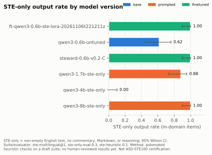
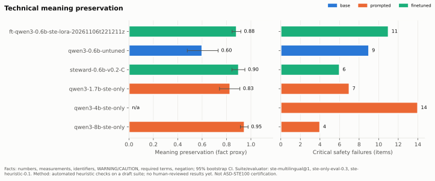
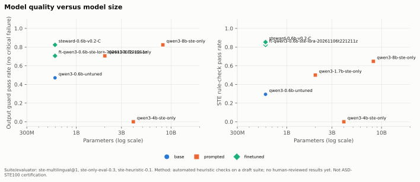
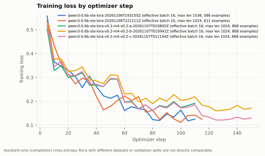

# STEward

STEward is an open-source research and engineering project for generating,
rewriting, and evaluating aerospace technical documentation in
ASD-STE100 Simplified Technical English (STE). The reference is
ASD-STE100 Issue 9 (January 2025).

> **Disclaimer:** STEward output is *STE-oriented*. A linter result, model
> output, or benchmark score from this project is not a certification of
> ASD-STE100 compliance. All synthetic scenarios are fictional and are not
> approved aircraft instructions.

## Status

* Done: project foundation and synthetic dataset generation with a local
  Ollama teacher ([docs/generation.md](docs/generation.md)).
* Done: benchmark tracking with a draft golden suite, heuristic STE rule checks,
  append-only history, regression detection, figures, and Claude Code hooks
  ([docs/benchmark-system.md](docs/benchmark-system.md)).
* Done (experimental): STE-only students for Qwen3-0.6B. v0.1: LoRA on 611
  synthetic examples. v0.2 (Milestone 4): targeted fidelity data, an independent
  LLM critique, best-checkpoint selection, and a 3-trial sweep selected on a
  development suite; trial C halves the critical safety failures of v0.1 on the
  draft suite (11 → 6) ([docs/training.md](docs/training.md),
  [docs/dataset-quality.md](docs/dataset-quality.md)). It is not ready for use: it
  still makes critical safety errors (see the benchmarks below).
* Not implemented yet: a full STE linter, human review, and publishing.

## Quick start

STEward uses [Pixi](https://pixi.sh) for all environment and dependency
management. Do not use pip, venv, Poetry, or uv directly.

```bash
pixi install            # create the default (dev) environment
pixi run steward info   # show version and runtime information
pixi run check          # format check, lint, type check, tests
```

Use a trained adapter (STE-only output, or a failure status):

```bash
pixi run -e cuda infer runs/<run_id> --input "VORSICHT: Den Sensor TS-9 nicht mit Wasser reinigen."
```

Generate synthetic candidates with a local teacher model:

```bash
pixi run -e ollama ollama-serve                 # in its own terminal
pixi run -e ollama ollama-pull qwen3:8b
pixi run steward generate --model qwen3:8b --count 100 --output data/raw/examples.jsonl --think off
```

## Pixi environments

| Environment | Features     | Purpose                                         |
|-------------|--------------|-------------------------------------------------|
| `default`   | `dev`        | CPU-only development: Ruff, mypy, pytest.       |
| `cuda`      | `dev`,`cuda` | Linux GPU stack: PyTorch (CUDA >= 12.8), Transformers, PEFT, TRL. Training and local inference. |
| `ollama`    | `ollama`     | Local Ollama server (CUDA build) for teacher models. |

The `cuda` environment targets an NVIDIA RTX 5090 (Blackwell), which needs
CUDA 12.8 or later. CI and unit tests never require a GPU.

```bash
pixi run -e cuda cuda-info   # confirm PyTorch can see the GPU
```

## Tasks

| Task           | What it does                                  |
|----------------|-----------------------------------------------|
| `format`       | Format code and sort imports with Ruff.       |
| `format-check` | Check formatting without changes.             |
| `lint`         | Lint with Ruff.                               |
| `typecheck`    | Strict type check with mypy.                  |
| `test`         | Run the CPU-only pytest suite.                |
| `test-cov`     | Run tests with a coverage report.             |
| `test-ollama`  | Opt-in live tests (needs Ollama and `STEWARD_OLLAMA_MODEL`). |
| `benchmark`    | Benchmark candidates without a current result (needs Ollama). |
| `benchmark-report` | Regenerate figures, report, and this README's benchmark block. |
| `benchmark-status` | Show pending work and stale results. |
| `benchmark-check`  | Verify history, golden suite, links, and generated files. |
| `check`        | Format check, lint, type check, tests, benchmark check (CI). |
| `benchmark-plot` | Regenerate the benchmark figures only. |
| `benchmark-verify` | Verify history integrity, golden suites, and training data. |
| `prepare-sft`  | Build the deterministic SFT train/validation split (`data/sft/v2`). |
| `-e cuda train` | LoRA SFT of Qwen3-0.6B (GPU; never runs automatically). |
| `-e cuda infer` | STE-only inference with the output guard: `infer runs/<id> --input "text"`. |
| `-e cuda ste`  | The same, with the text as an argument or on standard input. Uses the latest completed run unless `--model` is given. |
| `-e cuda export-ollama` | Merge a run (default: latest), convert it to GGUF, and write an Ollama Modelfile to `runs/ollama-export/`. |
| `ollama-create` | Export a run (default: latest) and import it into the running Ollama server as `steward-ste`. |
| `ollama-chat`  | Chat with `steward-ste` (each message is converted on its own; no output guard). |
| `-e cuda evaluate` | Benchmark a training run and its untuned baseline: `evaluate runs/<id>`. |
| `-e cuda benchmark-gpu` | Benchmark candidates (including trained adapters) on the GPU. |
| `-e cuda test-gpu` | Opt-in GPU tests (real tokenizer, adapter reload). |
| `prepare-sft-v3` | Build the Milestone 4 SFT set `data/sft/v3` from critiqued data. |
| `dataset-report` | Write the data-quality report ([docs/dataset-quality.md](docs/dataset-quality.md)). |
| `-e cuda train-sweep` | Train the Milestone 4 sweep trials A, B, C (never automatic). |
| `-e cuda sweep-select` | Evaluate the trials on the development suite and select one. |

Tests that need a GPU or network access must be marked `gpu` or `network`.

## Layout

```text
src/steward/
├── cli.py          # `steward` command
├── environment.py  # runtime info for provenance records
├── generation/     # teacher-model adapters, prompts, linter-guided repair
├── datasets/       # schemas, validation, SFT split preparation
├── ste/            # STE-oriented rule checks, cross-language preservation checks
├── evaluation/     # benchmarks, metrics, figures, reports
├── inference/      # STE-only API, output guard, Transformers backend
├── training/       # LoRA SFT with TRL and PEFT
└── publishing/     # Hugging Face cards and opt-in upload
```

See [AGENTS.md](AGENTS.md) for the full project rules.

## License

Code is licensed under the [Apache License 2.0](LICENSE). The ASD-STE100
standard itself is copyrighted by ASD and is not included in this repository.

<!-- benchmarks:start -->

## Benchmarks

6 candidates evaluated on `ste-multilingual` v1 (draft suite). No candidate meets the quality requirements yet.









Full report, regressions, and the experiment history: [docs/benchmarks.md](docs/benchmarks.md). Automated heuristic checks only; not ASD-STE100 certification.

<!-- benchmarks:end -->
