<!-- Generated by `steward benchmark report`. Do not edit by hand. -->

# STEward benchmarks

> **Not a certification.** These are automated, heuristic checks. A high score does not
> mean the output is ASD-STE100 compliant. Automated, human-reviewed, and LLM-judged
> metrics are kept separate; only automated metrics exist so far.

How the benchmark system and its Claude Code hooks work: [benchmark-system.md](benchmark-system.md).

## Primary suite: `ste-multilingual` v1

* 44 items, sha256 `44f4c1431221ed5a`, contract `ste_only_text`
* Review state: **draft**. Drafted by Claude (claude-opus-5-5) for STEward on 2026-11-06, including the German, French, and Romanian sources and all reference texts. Not yet reviewed by a human or a native speaker.
* Comparability key for new results: `ste-multilingual@1:44f4c143|ste-only-eval-0.3|ste-heuristic-0.1:0096b28d`
* Decoding: temperature 0.0, seed 1234, max tokens 768

> **Draft suite.** A human has not reviewed the golden items yet. Treat these results
> as development signals only, not as release evidence.

### Latest comparable results

| Candidate | Role | Params | Quant. | Tech. errors | Critical | Meaning | Negation | Labels | IDs | Added | STE-only | STE pass | OOD refusal | Rewrote STE | Non-EN | chrF | Latency s | Experiment |
|---|---|---|---|---|---|---|---|---|---|---|---|---|---|---|---|---|---|---|
| `ft-qwen3-0.6b-ste-lora-20261106t221211z` | finetuned | 0.60B | n/a | 10 | 11 | 0.88 | 0.85 | 0.75 | 0.94 | 0.09 | 1.00 | 0.82 [0.66, 0.92] | 0.90 | 0.40 | 0.00 | 63.4 | 0.41 | `bench-9e247223b5d69ee7` |
| `ft-qwen3-0.6b-ste-lora-v0.2-m4-v0.2-c-20261107t011144z` | finetuned | 0.60B | n/a | 6 | 6 | 0.90 | 1.00 | 0.83 | 0.94 | 0.06 | 1.00 | 0.85 [0.70, 0.94] | 1.00 | 0.20 | 0.00 | 65.1 | 0.42 | `bench-4c91611139324da8` |
| `qwen3-0.6b-untuned` | base | 0.60B | n/a | 18 | 9 | 0.60 | 0.67 | 0.30 | 1.00 | 0.00 | 0.62 | 0.29 [0.17, 0.46] | 0.80 | 0.20 | 0.28 | 44.3 | 0.43 | `bench-c1cd7db36c36881d` |
| `qwen3-1.7b-ste-only` | prompted | 2.00B | Q4_K_M | 10 | 7 | 0.83 | 0.85 | 0.42 | 1.00 | 0.00 | 0.88 | 0.50 [0.34, 0.66] | 0.70 | 0.00 | 0.12 | 58.7 | 0.28 | `bench-7fb70ca6e6f55f89` |
| `qwen3-4b-ste-only` | prompted | 4.00B | Q4_K_M | 34 | 14 | n/a | n/a | n/a | n/a | n/a | 0.00 | 0.00 [0.00, 0.10] | 0.00 | 1.00 | n/a | n/a | 1.02 | `bench-37560072910d2d9e` |
| `qwen3-8b-ste-only` | prompted | 8.20B | Q4_K_M | 6 | 4 | 0.95 | 0.85 | 0.83 | 1.00 | 0.03 | 1.00 | 0.65 [0.48, 0.79] | 0.90 | 0.20 | 0.00 | 63.9 | 0.33 | `bench-9d40b89fa055a19c` |

Denominators: 34 in-domain items for quality and STE-only rates, 10 out-of-domain items for the refusal rate, 5 identity items for 'Rewrote STE'. Meaning is a fact proxy (numbers, measurements, identifiers, safety labels, required terms, negation). chrF is measured against draft reference texts. Guard pass = the inference output guard accepted or flagged (did not reject) the output. Tech. errors = in-domain items with a failed fidelity check (facts, labels, negation, order, terminology fixtures, untranslated words, contradiction, language, omission) or a refusal. Critical = safety-critical items with such an error, or a lost safety label. Safety and fidelity columns come first: a higher STE pass rate never outweighs more technical errors.

### Results by source language

| Candidate | en meaning / chrF / STE-only | de meaning / chrF / STE-only | fr meaning / chrF / STE-only | ro meaning / chrF / STE-only |
|---|---|---|---|---|
| `ft-qwen3-0.6b-ste-lora-20261106t221211z` | 0.94 / 75.0 / 1.00 | 0.89 / 49.7 / 1.00 | 0.86 / 56.2 / 1.00 | 0.80 / 57.5 / 1.00 |
| `ft-qwen3-0.6b-ste-lora-v0.2-m4-v0.2-c-20261107t011144z` | 1.00 / 77.2 / 1.00 | 0.86 / 49.1 / 1.00 | 0.80 / 58.3 / 1.00 | 0.86 / 60.5 / 1.00 |
| `qwen3-0.6b-untuned` | 0.87 / 66.3 / 0.93 | 0.49 / 25.9 / 0.43 | 0.54 / 36.9 / 0.50 | 0.29 / 18.2 / 0.17 |
| `qwen3-1.7b-ste-only` | 1.00 / 73.2 / 1.00 | 0.65 / 40.4 / 0.71 | 0.69 / 44.7 / 0.67 | 0.86 / 57.7 / 1.00 |
| `qwen3-4b-ste-only` | n/a / n/a / 0.00 | n/a / n/a / 0.00 | n/a / n/a / 0.00 | n/a / n/a / 0.00 |
| `qwen3-8b-ste-only` | 0.95 / 73.1 / 1.00 | 0.97 / 55.0 / 1.00 | 0.89 / 49.7 / 1.00 | 0.97 / 65.2 / 1.00 |

### Model selection

The selected model is the **smallest** candidate that meets every requirement in `benchmarks/thresholds.toml`. Size decides only among candidates that meet all requirements:

critical_failures <= 0.0, hallucination_rate <= 0.0, meaning_preservation >= 0.95, missing_information_rate <= 0.1, ste_only_output_rate >= 0.98, non_english_output_rate <= 0.0, extra_commentary_rate <= 0.0, controlled_failure_reliability >= 0.9, false_refusal_rate <= 0.05, ste_rule_pass_rate >= 0.8, unnecessary_rewrite_rate <= 0.2, technical_error_rate <= 0.05, safety_label_preservation >= 1.0, negation_preservation >= 1.0.

**No candidate meets the requirements yet.**

* `ft-qwen3-0.6b-ste-lora-20261106t221211z` does not meet: critical_failures = 11.000 (max 0.0); hallucination_rate = 0.088 (max 0.0); meaning_preservation = 0.882 (min 0.95); missing_information_rate = 0.412 (max 0.1); unnecessary_rewrite_rate = 0.400 (max 0.2); technical_error_rate = 0.294 (max 0.05); safety_label_preservation = 0.750 (min 1.0); negation_preservation = 0.846 (min 1.0)
* `ft-qwen3-0.6b-ste-lora-v0.2-m4-v0.2-c-20261107t011144z` does not meet: critical_failures = 6.000 (max 0.0); hallucination_rate = 0.059 (max 0.0); meaning_preservation = 0.900 (min 0.95); missing_information_rate = 0.294 (max 0.1); technical_error_rate = 0.176 (max 0.05); safety_label_preservation = 0.833 (min 1.0)
* `qwen3-0.6b-untuned` does not meet: critical_failures = 9.000 (max 0.0); meaning_preservation = 0.600 (min 0.95); missing_information_rate = 0.529 (max 0.1); ste_only_output_rate = 0.618 (min 0.98); non_english_output_rate = 0.276 (max 0.0); controlled_failure_reliability = 0.800 (min 0.9); false_refusal_rate = 0.147 (max 0.05); ste_rule_pass_rate = 0.294 (min 0.8); technical_error_rate = 0.529 (max 0.05); safety_label_preservation = 0.300 (min 1.0); negation_preservation = 0.667 (min 1.0)
* `qwen3-1.7b-ste-only` does not meet: critical_failures = 7.000 (max 0.0); meaning_preservation = 0.829 (min 0.95); missing_information_rate = 0.324 (max 0.1); ste_only_output_rate = 0.882 (min 0.98); non_english_output_rate = 0.118 (max 0.0); controlled_failure_reliability = 0.700 (min 0.9); ste_rule_pass_rate = 0.500 (min 0.8); technical_error_rate = 0.294 (max 0.05); safety_label_preservation = 0.417 (min 1.0); negation_preservation = 0.846 (min 1.0)
* `qwen3-4b-ste-only` does not meet: critical_failures = 14.000 (max 0.0); meaning_preservation is not available; missing_information_rate = 1.000 (max 0.1); ste_only_output_rate = 0.000 (min 0.98); non_english_output_rate is not available; extra_commentary_rate is not available; controlled_failure_reliability = 0.000 (min 0.9); ste_rule_pass_rate = 0.000 (min 0.8); unnecessary_rewrite_rate = 1.000 (max 0.2); technical_error_rate = 1.000 (max 0.05); safety_label_preservation is not available; negation_preservation is not available
* `qwen3-8b-ste-only` does not meet: critical_failures = 4.000 (max 0.0); hallucination_rate = 0.029 (max 0.0); meaning_preservation = 0.947 (min 0.95); missing_information_rate = 0.176 (max 0.1); ste_rule_pass_rate = 0.647 (min 0.8); technical_error_rate = 0.176 (max 0.05); safety_label_preservation = 0.833 (min 1.0); negation_preservation = 0.846 (min 1.0)

### Comparisons and regressions

* `ft-qwen3-0.6b-ste-lora-20261106t221211z` vs. untuned base `qwen3-0.6b-untuned`: **critical** critical_failures: 11 critical safety failure(s): lost WARNING/CAUTION labels or missing/invented facts in safety-critical items. Human review is required.; **improvement** ste_rule_pass_rate: Improved by 0.529. (CIs separated); **improvement** grammar_violations_per_100_words: Reduced by 1.361.; **improvement** meaning_preservation: Improved by 0.282. (CIs separated); **regression** hallucination_rate: Increased by 0.088 (limit 0.0).; **improvement** missing_information_rate: Reduced by 0.118.; **improvement** ste_only_output_rate: Improved by 0.382. (CIs separated); **improvement** non_english_output_rate: Reduced by 0.276. (CIs separated); **improvement** chrf_mean: Improved by 19.033. (CIs separated); **improvement** technical_error_rate: Reduced by 0.235.; **regression** critical_failures: Increased by 2.000 (limit 0.0).; **improvement** negation_preservation: Improved by 0.179.; **improvement** safety_label_preservation: Improved by 0.450.; **regression** terminology_preservation: Dropped by 0.059 (limit 0.0).; **regression** unsupported_addition_rate: Increased by 0.088 (limit 0.0).
* `ft-qwen3-0.6b-ste-lora-20261106t221211z` vs. best of equal or smaller size `ft-qwen3-0.6b-ste-lora-v0.2-m4-v0.2-c-20261107t011144z`: **critical** critical_failures: 11 critical safety failure(s): lost WARNING/CAUTION labels or missing/invented facts in safety-critical items. Human review is required.; **regression** hallucination_rate: Increased by 0.029 (limit 0.0).; **regression** missing_information_rate: Increased by 0.118 (limit 0.05).; **regression** technical_error_rate: Increased by 0.118 (limit 0.0).; **regression** critical_failures: Increased by 5.000 (limit 0.0).; **regression** negation_preservation: Dropped by 0.154 (limit 0.0).; **regression** safety_label_preservation: Dropped by 0.083 (limit 0.0).; **regression** unsupported_addition_rate: Increased by 0.029 (limit 0.0).
* `ft-qwen3-0.6b-ste-lora-v0.2-m4-v0.2-c-20261107t011144z` vs. untuned base `qwen3-0.6b-untuned`: **critical** critical_failures: 6 critical safety failure(s): lost WARNING/CAUTION labels or missing/invented facts in safety-critical items. Human review is required.; **improvement** ste_rule_pass_rate: Improved by 0.559. (CIs separated); **improvement** grammar_violations_per_100_words: Reduced by 1.495.; **improvement** meaning_preservation: Improved by 0.300. (CIs separated); **regression** hallucination_rate: Increased by 0.059 (limit 0.0).; **improvement** missing_information_rate: Reduced by 0.235.; **improvement** ste_only_output_rate: Improved by 0.382. (CIs separated); **improvement** non_english_output_rate: Reduced by 0.276. (CIs separated); **improvement** controlled_failure_reliability: Improved by 0.200.; **improvement** chrf_mean: Improved by 20.788. (CIs separated); **improvement** technical_error_rate: Reduced by 0.353. (CIs separated); **improvement** critical_failures: Reduced by 3.000.; **improvement** negation_preservation: Improved by 0.333.; **improvement** safety_label_preservation: Improved by 0.533.; **regression** terminology_preservation: Dropped by 0.059 (limit 0.0).; **regression** unsupported_addition_rate: Increased by 0.059 (limit 0.0).
* `ft-qwen3-0.6b-ste-lora-v0.2-m4-v0.2-c-20261107t011144z` vs. best of equal or smaller size `ft-qwen3-0.6b-ste-lora-20261106t221211z`: **critical** critical_failures: 6 critical safety failure(s): lost WARNING/CAUTION labels or missing/invented facts in safety-critical items. Human review is required.; **improvement** hallucination_rate: Reduced by 0.029.; **improvement** missing_information_rate: Reduced by 0.118.; **improvement** technical_error_rate: Reduced by 0.118.; **improvement** critical_failures: Reduced by 5.000.; **improvement** negation_preservation: Improved by 0.154.; **improvement** safety_label_preservation: Improved by 0.083.; **improvement** unsupported_addition_rate: Reduced by 0.029.
* `qwen3-0.6b-untuned` vs. best of equal or smaller size `ft-qwen3-0.6b-ste-lora-v0.2-m4-v0.2-c-20261107t011144z`: **critical** critical_failures: 9 critical safety failure(s): lost WARNING/CAUTION labels or missing/invented facts in safety-critical items. Human review is required.; **regression** ste_rule_pass_rate: Dropped by 0.559 (limit 0.05). (CIs separated); **regression** grammar_violations_per_100_words: Increased by 1.495 (limit 0.5).; **regression** meaning_preservation: Dropped by 0.300 (limit 0.03). (CIs separated); **improvement** hallucination_rate: Reduced by 0.059.; **regression** missing_information_rate: Increased by 0.235 (limit 0.05).; **regression** ste_only_output_rate: Dropped by 0.382 (limit 0.02). (CIs separated); **regression** non_english_output_rate: Increased by 0.276 (limit 0.0). (CIs separated); **regression** controlled_failure_reliability: Dropped by 0.200 (limit 0.1).; **regression** chrf_mean: Dropped by 20.788 (limit 2.0). (CIs separated); **regression** technical_error_rate: Increased by 0.353 (limit 0.0). (CIs separated); **regression** critical_failures: Increased by 3.000 (limit 0.0).; **regression** negation_preservation: Dropped by 0.333 (limit 0.0).; **regression** safety_label_preservation: Dropped by 0.533 (limit 0.0).; **improvement** terminology_preservation: Improved by 0.059.; **improvement** unsupported_addition_rate: Reduced by 0.059.
* `qwen3-1.7b-ste-only` vs. best of equal or smaller size `ft-qwen3-0.6b-ste-lora-v0.2-m4-v0.2-c-20261107t011144z`: **critical** critical_failures: 7 critical safety failure(s): lost WARNING/CAUTION labels or missing/invented facts in safety-critical items. Human review is required.; **regression** ste_rule_pass_rate: Dropped by 0.353 (limit 0.05). (CIs separated); **regression** grammar_violations_per_100_words: Increased by 1.181 (limit 0.5).; **regression** meaning_preservation: Dropped by 0.071 (limit 0.03).; **improvement** hallucination_rate: Reduced by 0.059.; **improvement** latency_mean_s: -32% faster.; **regression** ste_only_output_rate: Dropped by 0.118 (limit 0.02).; **regression** non_english_output_rate: Increased by 0.118 (limit 0.0).; **regression** controlled_failure_reliability: Dropped by 0.300 (limit 0.1).; **regression** chrf_mean: Dropped by 6.399 (limit 2.0).; **regression** technical_error_rate: Increased by 0.118 (limit 0.0).; **regression** critical_failures: Increased by 1.000 (limit 0.0).; **regression** negation_preservation: Dropped by 0.154 (limit 0.0).; **regression** safety_label_preservation: Dropped by 0.417 (limit 0.0).; **improvement** terminology_preservation: Improved by 0.059.; **improvement** unsupported_addition_rate: Reduced by 0.059.
* `qwen3-4b-ste-only` vs. best of equal or smaller size `ft-qwen3-0.6b-ste-lora-v0.2-m4-v0.2-c-20261107t011144z`: **critical** critical_failures: 14 critical safety failure(s): lost WARNING/CAUTION labels or missing/invented facts in safety-critical items. Human review is required.; **regression** ste_rule_pass_rate: Dropped by 0.853 (limit 0.05). (CIs separated); **improvement** hallucination_rate: Reduced by 0.059.; **regression** missing_information_rate: Increased by 0.706 (limit 0.05). (CIs separated); **regression** latency_mean_s: +145% slower (limit +25%).; **regression** disk_size_bytes: +58% larger on disk, but STE pass rate changed only -0.853 (needs at least +0.030).; **regression** ste_only_output_rate: Dropped by 1.000 (limit 0.02). (CIs separated); **regression** controlled_failure_reliability: Dropped by 1.000 (limit 0.1). (CIs separated); **regression** technical_error_rate: Increased by 0.824 (limit 0.0). (CIs separated); **regression** critical_failures: Increased by 8.000 (limit 0.0).
* `qwen3-8b-ste-only` vs. best of equal or smaller size `ft-qwen3-0.6b-ste-lora-v0.2-m4-v0.2-c-20261107t011144z`: **critical** critical_failures: 4 critical safety failure(s): lost WARNING/CAUTION labels or missing/invented facts in safety-critical items. Human review is required.; **regression** ste_rule_pass_rate: Dropped by 0.206 (limit 0.05).; **regression** grammar_violations_per_100_words: Increased by 0.921 (limit 0.5).; **improvement** meaning_preservation: Improved by 0.047.; **improvement** hallucination_rate: Reduced by 0.029.; **improvement** missing_information_rate: Reduced by 0.118.; **regression** disk_size_bytes: +230% larger on disk, but STE pass rate changed only -0.206 (needs at least +0.030).; **improvement** critical_failures: Reduced by 2.000.; **regression** negation_preservation: Dropped by 0.154 (limit 0.0).; **improvement** terminology_preservation: Improved by 0.059.; **improvement** unsupported_addition_rate: Reduced by 0.029.

## Other suite: `ste-golden` v0

* 16 items, sha256 `dd2da8314b223bad`, contract `json_rewrite`
* Review state: **draft**. Drafted by Claude (claude-opus-5-5) for STEward on 2026-11-06. Not yet reviewed by a human.
* Comparability key for new results: `ste-golden@0:dd2da831|eval-0.1|ste-heuristic-0.1:0096b28d`
* Decoding: temperature 0.0, seed 1234, max tokens 1024

> **Draft suite.** A human has not reviewed the golden items yet. Treat these results
> as development signals only, not as release evidence.

### Latest comparable results

| Candidate | Role | Params | Quant. | STE pass | Viol./100w | Gram./100w | Meaning | Halluc. | Missing | Critical | Complete | Tok/s | Latency s | Experiment |
|---|---|---|---|---|---|---|---|---|---|---|---|---|---|---|
| `qwen3-1.7b-base` | base | 2.00B | Q4_K_M | 0.06 [0.01, 0.28] | 10.5 | 8.5 | 0.99 | 0.00 | 0.06 | 1 | 1.00 | 453 | 0.41 | `bench-590d1f9e8031d22c` |
| `qwen3-1.7b-prompted` | prompted | 2.00B | Q4_K_M | 0.31 [0.14, 0.56] | 7.6 | 6.4 | 0.97 | 0.00 | 0.19 | 2 | 1.00 | 445 | 0.23 | `bench-9004068344ac3528` |
| `qwen3-4b-base` | base | 4.00B | Q4_K_M | 0.44 [0.23, 0.67] | 5.2 | 4.3 | 0.95 | 0.00 | 0.25 | 1 | 1.00 | 283 | 0.46 | `bench-cfd40a252d18d080` |
| `qwen3-4b-prompted` | prompted | 4.00B | Q4_K_M | 0.62 [0.39, 0.82] | 3.1 | 2.9 | 0.88 | 0.06 | 0.44 | 3 | 1.00 | 280 | 0.33 | `bench-653b6dd3eb7dddd8` |
| `qwen3-8b-base` | base | 8.20B | Q4_K_M | 0.44 [0.23, 0.67] | 6.6 | 5.5 | 0.98 | 0.00 | 0.12 | 1 | 1.00 | 198 | 0.55 | `bench-7d578c9fa1e202a5` |
| `qwen3-8b-prompted` | prompted | 8.20B | Q4_K_M | 0.50 [0.28, 0.72] | 6.4 | 6.1 | 0.96 | 0.00 | 0.25 | 3 | 1.00 | 206 | 0.39 | `bench-a9e575bcdea58a30` |

Denominators: 16 items per candidate; per-100-word rates use the output words of valid outputs. STE pass rate shows a 95% Wilson interval.

### Model selection

The selected model is the **smallest** candidate that meets every requirement in `benchmarks/thresholds.toml`. Size decides only among candidates that meet all requirements:

STE pass rate >= 0.8, meaning preservation >= 0.95, hallucination rate <= 0.0, missing-information rate <= 0.1, critical failures <= 0, task completion >= 1.0.

**No candidate meets the requirements yet.**

* `qwen3-1.7b-base` does not meet: ste_rule_pass_rate = 0.062 (min 0.8); critical_failures = 1.000 (max 0.0)
* `qwen3-1.7b-prompted` does not meet: ste_rule_pass_rate = 0.312 (min 0.8); missing_information_rate = 0.188 (max 0.1); critical_failures = 2.000 (max 0.0)
* `qwen3-4b-base` does not meet: ste_rule_pass_rate = 0.438 (min 0.8); meaning_preservation = 0.947 (min 0.95); missing_information_rate = 0.250 (max 0.1); critical_failures = 1.000 (max 0.0)
* `qwen3-4b-prompted` does not meet: ste_rule_pass_rate = 0.625 (min 0.8); meaning_preservation = 0.884 (min 0.95); hallucination_rate = 0.062 (max 0.0); missing_information_rate = 0.438 (max 0.1); critical_failures = 3.000 (max 0.0)
* `qwen3-8b-base` does not meet: ste_rule_pass_rate = 0.438 (min 0.8); missing_information_rate = 0.125 (max 0.1); critical_failures = 1.000 (max 0.0)
* `qwen3-8b-prompted` does not meet: ste_rule_pass_rate = 0.500 (min 0.8); missing_information_rate = 0.250 (max 0.1); critical_failures = 3.000 (max 0.0)

### Comparisons and regressions

* `qwen3-1.7b-base` vs. best of equal or smaller size `qwen3-1.7b-prompted`: **critical** critical_failures: 1 critical safety failure(s): lost WARNING/CAUTION labels or missing/invented facts in safety-critical items. Human review is required.; **regression** ste_rule_pass_rate: Dropped by 0.250 (limit 0.05).; **regression** grammar_violations_per_100_words: Increased by 2.165 (limit 0.5).; **improvement** missing_information_rate: Reduced by 0.125.; **regression** latency_mean_s: +77% slower (limit +25%).; **improvement** critical_failures: Reduced by 1.000.
* `qwen3-1.7b-prompted` vs. untuned base `qwen3-1.7b-base`: **critical** critical_failures: 2 critical safety failure(s): lost WARNING/CAUTION labels or missing/invented facts in safety-critical items. Human review is required.; **improvement** ste_rule_pass_rate: Improved by 0.250.; **improvement** grammar_violations_per_100_words: Reduced by 2.165.; **regression** missing_information_rate: Increased by 0.125 (limit 0.05).; **improvement** latency_mean_s: -44% faster.; **regression** critical_failures: Increased by 1.000 (limit 0.0).
* `qwen3-4b-base` vs. best of equal or smaller size `qwen3-4b-prompted`: **critical** critical_failures: 1 critical safety failure(s): lost WARNING/CAUTION labels or missing/invented facts in safety-critical items. Human review is required.; **regression** ste_rule_pass_rate: Dropped by 0.188 (limit 0.05).; **regression** grammar_violations_per_100_words: Increased by 1.454 (limit 0.5).; **improvement** meaning_preservation: Improved by 0.063.; **improvement** hallucination_rate: Reduced by 0.062.; **improvement** missing_information_rate: Reduced by 0.188.; **regression** latency_mean_s: +40% slower (limit +25%).; **improvement** critical_failures: Reduced by 2.000.
* `qwen3-4b-prompted` vs. untuned base `qwen3-4b-base`: **critical** critical_failures: 3 critical safety failure(s): lost WARNING/CAUTION labels or missing/invented facts in safety-critical items. Human review is required.; **improvement** ste_rule_pass_rate: Improved by 0.188.; **improvement** grammar_violations_per_100_words: Reduced by 1.454.; **regression** meaning_preservation: Dropped by 0.063 (limit 0.03).; **regression** hallucination_rate: Increased by 0.062 (limit 0.0).; **regression** missing_information_rate: Increased by 0.188 (limit 0.05).; **improvement** latency_mean_s: -29% faster.; **regression** critical_failures: Increased by 2.000 (limit 0.0).
* `qwen3-8b-base` vs. best of equal or smaller size `qwen3-4b-prompted`: **critical** critical_failures: 1 critical safety failure(s): lost WARNING/CAUTION labels or missing/invented facts in safety-critical items. Human review is required.; **regression** ste_rule_pass_rate: Dropped by 0.188 (limit 0.05).; **regression** grammar_violations_per_100_words: Increased by 2.684 (limit 0.5). (CIs separated); **improvement** meaning_preservation: Improved by 0.095.; **improvement** hallucination_rate: Reduced by 0.062.; **improvement** missing_information_rate: Reduced by 0.312.; **regression** latency_mean_s: +69% slower (limit +25%).; **regression** disk_size_bytes: +109% larger on disk, but STE pass rate changed only -0.188 (needs at least +0.030).; **improvement** critical_failures: Reduced by 2.000.
* `qwen3-8b-prompted` vs. untuned base `qwen3-8b-base`: **critical** critical_failures: 3 critical safety failure(s): lost WARNING/CAUTION labels or missing/invented facts in safety-critical items. Human review is required.; **improvement** ste_rule_pass_rate: Improved by 0.062.; **regression** grammar_violations_per_100_words: Increased by 0.535 (limit 0.5).; **regression** missing_information_rate: Increased by 0.125 (limit 0.05).; **improvement** latency_mean_s: -29% faster.; **regression** critical_failures: Increased by 2.000 (limit 0.0).
* `qwen3-8b-prompted` vs. best of equal or smaller size `qwen3-4b-prompted`: **critical** critical_failures: 3 critical safety failure(s): lost WARNING/CAUTION labels or missing/invented facts in safety-critical items. Human review is required.; **regression** ste_rule_pass_rate: Dropped by 0.125 (limit 0.05).; **regression** grammar_violations_per_100_words: Increased by 3.219 (limit 0.5).; **improvement** meaning_preservation: Improved by 0.074.; **improvement** hallucination_rate: Reduced by 0.062.; **improvement** missing_information_rate: Reduced by 0.188.; **regression** disk_size_bytes: +109% larger on disk, but STE pass rate changed only -0.125 (needs at least +0.030).

## Training runs

| Run | Status | Label | Train / val examples | Steps | Last train loss | Last val loss | Dataset | Experiment |
|---|---|---|---|---|---|---|---|---|
| `qwen3-0.6b-ste-lora-20261106T193155Z` | completed | experimental | 586 / 103 | 111 | 0.126 | 0.281 | `99076a484754` | `train-b6063f54ca86ef1f` |
| `qwen3-0.6b-ste-lora-20261106T221211Z` | completed | experimental | 611 / 78 | 117 | 0.125 | 0.302 | `29272e8812c1` | `train-6f26b35efddd9a0c` |
| `qwen3-0.6b-ste-lora-v0.2-m4-v0.2-a-20261107T010805Z` | completed | experimental | 868 / 111 | 110 | 0.192 | 0.268 | `556cf4912f06` | `train-21a46190b71e8a7b` |
| `qwen3-0.6b-ste-lora-v0.2-m4-v0.2-b-20261107T010942Z` | completed | experimental | 868 / 111 | 150 | 0.172 | 0.271 | `556cf4912f06` | `train-a09d3605b7f4040b` |
| `qwen3-0.6b-ste-lora-v0.2-m4-v0.2-c-20261107T011144Z` | completed | experimental | 868 / 111 | 150 | 0.130 | 0.261 | `556cf4912f06` | `train-569c8e0ade7e00a9` |

## Outstanding work

* `bench-9fa46e91955a5ed5` (`qwen3-0.6b-untuned`) used `ste-multilingual@0:bf898412|ste-only-eval-0.1|ste-heuristic-0.1:0096b28d`; it is kept in the history but is not directly comparable with current results.
* `bench-e4b97b28c42dba0f` (`ft-qwen3-0.6b-ste-lora-20261106t193155z`) used `ste-multilingual@0:bf898412|ste-only-eval-0.1|ste-heuristic-0.1:0096b28d`; it is kept in the history but is not directly comparable with current results.
* `bench-a54d4a119f81675a` (`qwen3-1.7b-ste-only`) used `ste-multilingual@0:bf898412|ste-only-eval-0.1|ste-heuristic-0.1:0096b28d`; it is kept in the history but is not directly comparable with current results.
* `bench-576431eca202a4c9` (`qwen3-4b-ste-only`) used `ste-multilingual@0:bf898412|ste-only-eval-0.1|ste-heuristic-0.1:0096b28d`; it is kept in the history but is not directly comparable with current results.
* `bench-2cda0537d90448a8` (`qwen3-8b-ste-only`) used `ste-multilingual@0:bf898412|ste-only-eval-0.1|ste-heuristic-0.1:0096b28d`; it is kept in the history but is not directly comparable with current results.
* `bench-7751b036173c899b` (`qwen3-0.6b-untuned`) used `ste-multilingual@1:44f4c143|ste-only-eval-0.2|ste-heuristic-0.1:0096b28d`; it is kept in the history but is not directly comparable with current results.
* `bench-e469a18dd2a48bd7` (`ft-qwen3-0.6b-ste-lora-20261106t221211z`) used `ste-multilingual@1:44f4c143|ste-only-eval-0.2|ste-heuristic-0.1:0096b28d`; it is kept in the history but is not directly comparable with current results.
* `bench-2e540a2829cc74f2` (`ft-qwen3-0.6b-ste-lora-20261106t193155z`) used `ste-multilingual@1:44f4c143|ste-only-eval-0.2|ste-heuristic-0.1:0096b28d`; it is kept in the history but is not directly comparable with current results.
* `bench-1dab314a6e1783cc` (`qwen3-1.7b-ste-only`) used `ste-multilingual@1:44f4c143|ste-only-eval-0.2|ste-heuristic-0.1:0096b28d`; it is kept in the history but is not directly comparable with current results.
* `bench-8b543fd2c514c95c` (`qwen3-4b-ste-only`) used `ste-multilingual@1:44f4c143|ste-only-eval-0.2|ste-heuristic-0.1:0096b28d`; it is kept in the history but is not directly comparable with current results.
* `bench-ec5b4178b6104363` (`qwen3-8b-ste-only`) used `ste-multilingual@1:44f4c143|ste-only-eval-0.2|ste-heuristic-0.1:0096b28d`; it is kept in the history but is not directly comparable with current results.
* `bench-814b5c09fce93084` (`qwen3-0.6b-untuned`) used `ste-fidelity-dev@0:c49b2b7e|ste-only-eval-0.3|ste-heuristic-0.1:0096b28d`; it is kept in the history but is not directly comparable with current results.
* `bench-de5c80d9bfcb27f2` (`ft-qwen3-0.6b-ste-lora-20261106t221211z`) used `ste-fidelity-dev@0:c49b2b7e|ste-only-eval-0.3|ste-heuristic-0.1:0096b28d`; it is kept in the history but is not directly comparable with current results.
* `bench-396d1878accd986c` (`ft-qwen3-0.6b-ste-lora-v0.2-m4-v0.2-a-20261107t010805z`) used `ste-fidelity-dev@0:c49b2b7e|ste-only-eval-0.3|ste-heuristic-0.1:0096b28d`; it is kept in the history but is not directly comparable with current results.
* `bench-95d844a29e432f5f` (`ft-qwen3-0.6b-ste-lora-v0.2-m4-v0.2-b-20261107t010942z`) used `ste-fidelity-dev@0:c49b2b7e|ste-only-eval-0.3|ste-heuristic-0.1:0096b28d`; it is kept in the history but is not directly comparable with current results.
* `bench-36c48357b4dcd5bb` (`ft-qwen3-0.6b-ste-lora-v0.2-m4-v0.2-c-20261107t011144z`) used `ste-fidelity-dev@0:c49b2b7e|ste-only-eval-0.3|ste-heuristic-0.1:0096b28d`; it is kept in the history but is not directly comparable with current results.

## Figures

### Ste compliance by model

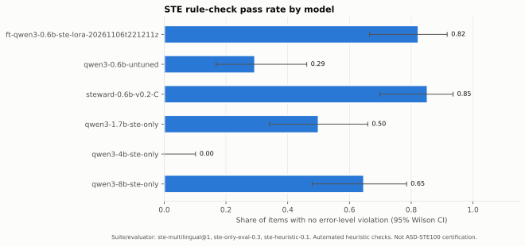

### Violations over time

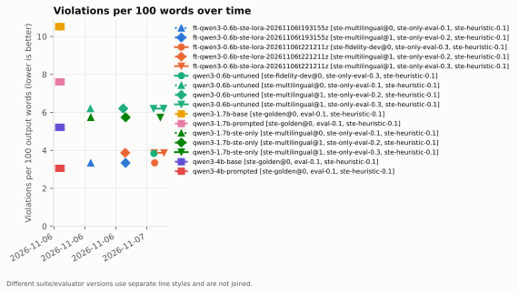

### Training loss

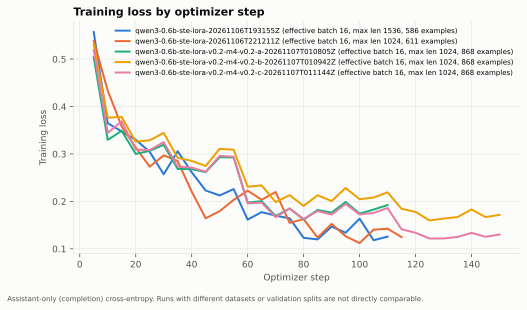

### Quality vs parameters

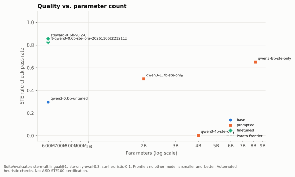

### Quality vs disk size

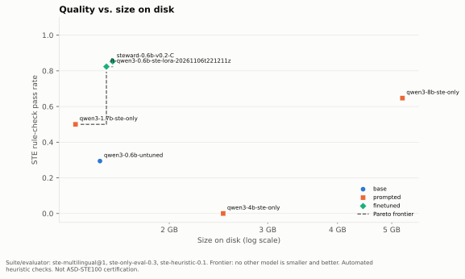

### Pareto frontier

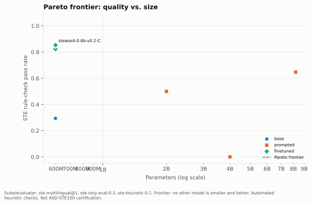

### Inference performance

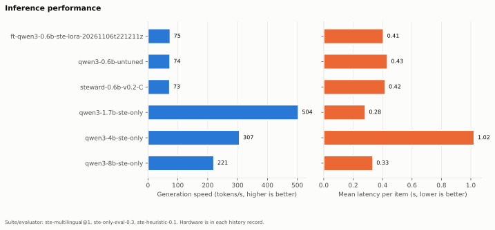

### Violation categories

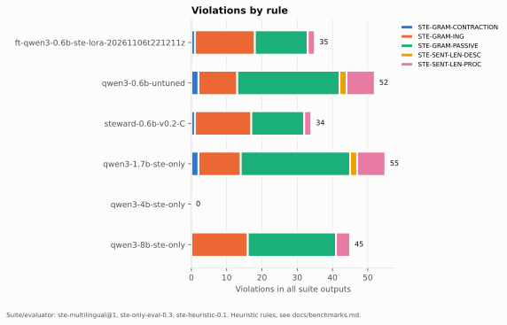

### Meaning vs compliance

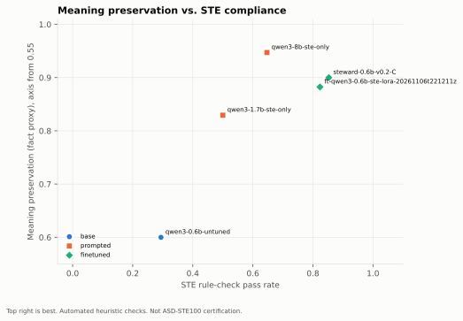

### Output length repetition

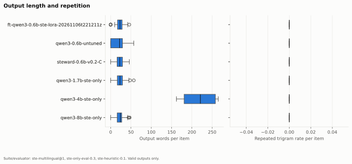

### Baseline finetuned quantized

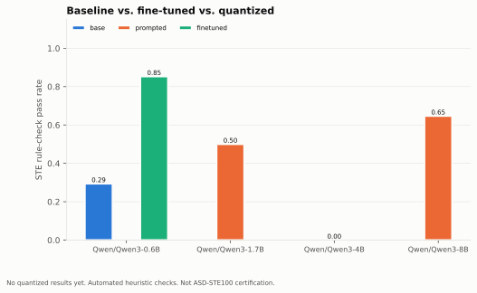

### Ste only output rate

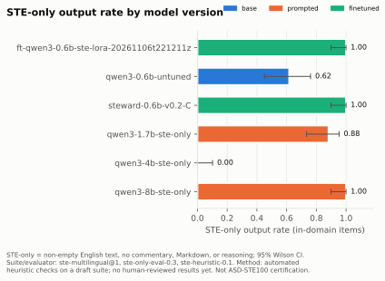

### Non english output rate

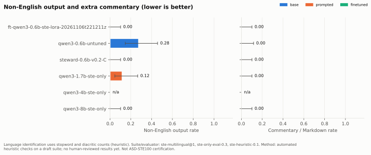

### Translation quality by language

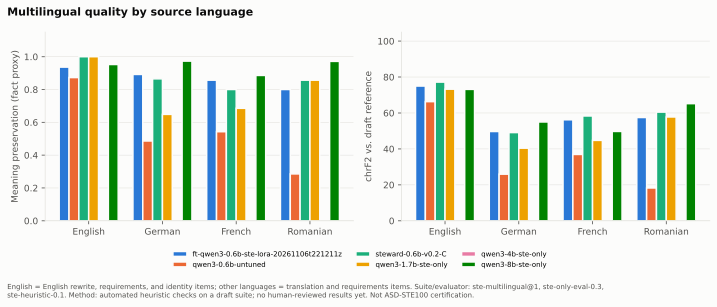

### Technical meaning preservation

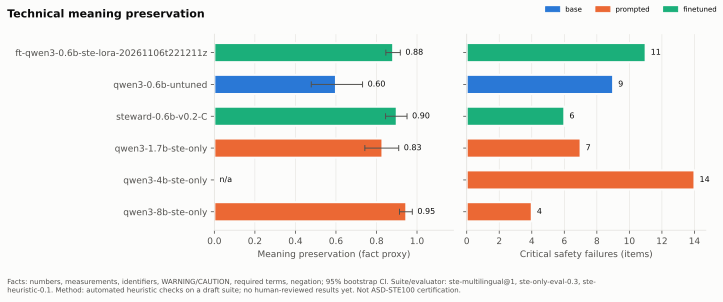

### Out of domain handling

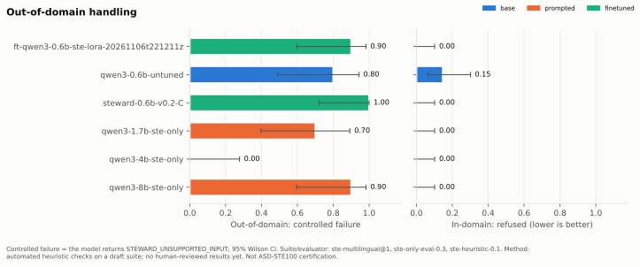

### Unnecessary rewriting

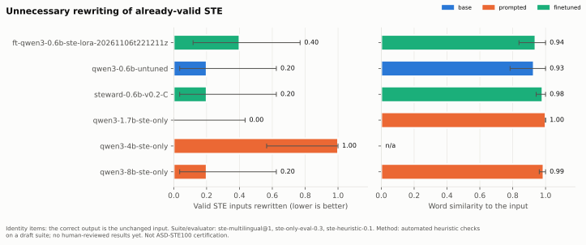

### Ste violations per 100 words

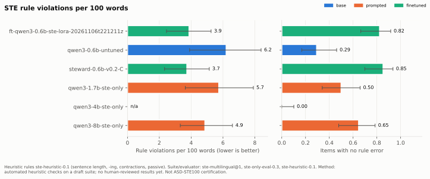

### Quality vs size

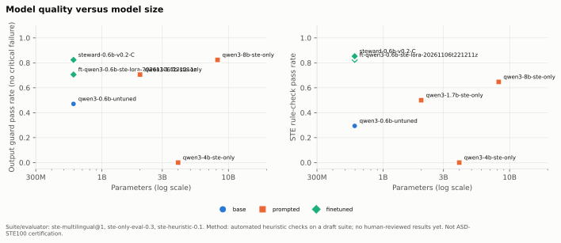

### Validation loss

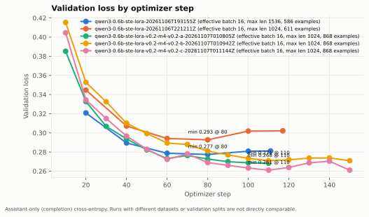

### Model size

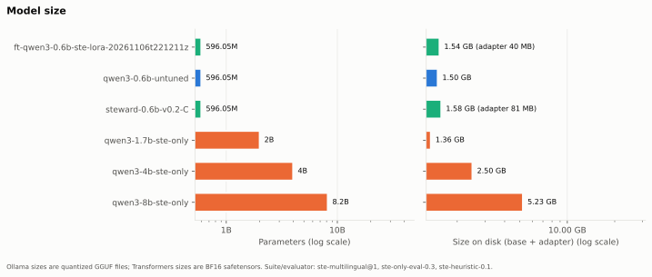

### Model improvement history

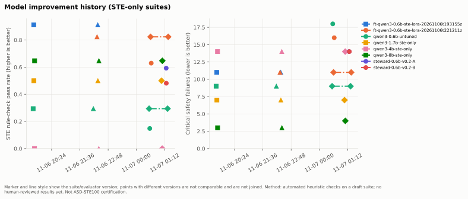

### Safety label preservation

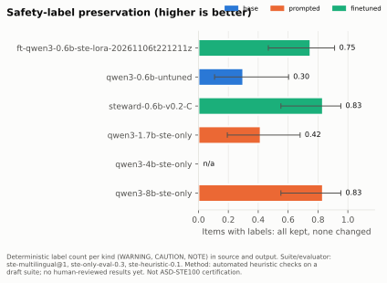

### Negation preservation

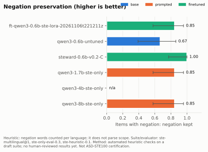

### Identifier preservation

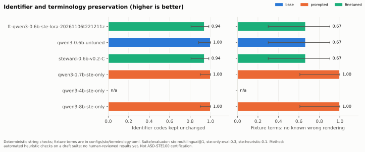

### Version comparison

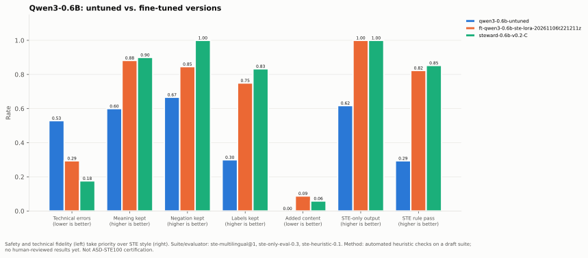

### Compliance vs critical errors

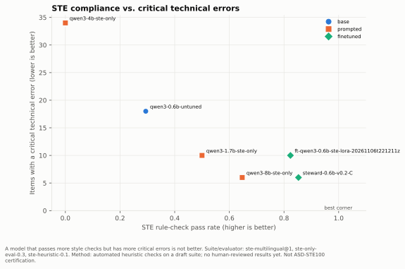

### Hyperparameter trials

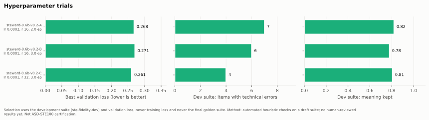

### Error distribution

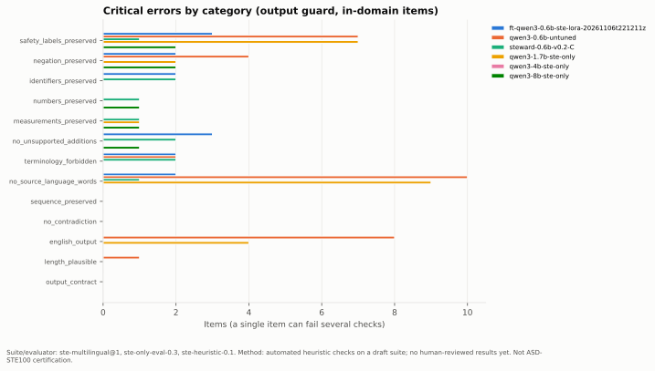

## Experiment history

Full records: [`benchmarks/results/history.jsonl`](../benchmarks/results/history.jsonl).

| # | Experiment | Type | Date (UTC) | Candidate / run | Status | Commit |
|---|---|---|---|---|---|---|
| 1 | `bench-46a76319b406bb66` | benchmark | 2026-11-06 17:08 | `qwen3-1.7b-base` | completed | `6a8fedd7+dirty` |
| 2 | `bench-c386bed9be113480` | benchmark | 2026-11-06 17:09 | `qwen3-1.7b-prompted` | completed | `6a8fedd7+dirty` |
| 3 | `bench-65be60a6d7180d41` | benchmark | 2026-11-06 17:09 | `qwen3-4b-base` | completed | `6a8fedd7+dirty` |
| 4 | `bench-0efa8739cc858b91` | benchmark | 2026-11-06 17:09 | `qwen3-4b-prompted` | completed | `6a8fedd7+dirty` |
| 5 | `bench-0d630fe8290ce473` | benchmark | 2026-11-06 17:09 | `qwen3-8b-base` | completed | `6a8fedd7+dirty` |
| 6 | `bench-22776f27609c93c4` | benchmark | 2026-11-06 17:09 | `qwen3-8b-prompted` | completed | `6a8fedd7+dirty` |
| 7 | `bench-590d1f9e8031d22c` | benchmark | 2026-11-06 17:20 | `qwen3-1.7b-base` | completed | `6a8fedd7+dirty` |
| 8 | `bench-9004068344ac3528` | benchmark | 2026-11-06 17:20 | `qwen3-1.7b-prompted` | completed | `6a8fedd7+dirty` |
| 9 | `bench-cfd40a252d18d080` | benchmark | 2026-11-06 17:20 | `qwen3-4b-base` | completed | `6a8fedd7+dirty` |
| 10 | `bench-653b6dd3eb7dddd8` | benchmark | 2026-11-06 17:20 | `qwen3-4b-prompted` | completed | `6a8fedd7+dirty` |
| 11 | `bench-7d578c9fa1e202a5` | benchmark | 2026-11-06 17:20 | `qwen3-8b-base` | completed | `6a8fedd7+dirty` |
| 12 | `bench-a9e575bcdea58a30` | benchmark | 2026-11-06 17:20 | `qwen3-8b-prompted` | completed | `6a8fedd7+dirty` |
| 13 | `train-b6063f54ca86ef1f` | training | 2026-11-06 19:35 | `qwen3-0.6b-ste-lora-20261106T193155Z` | completed | `6a8fedd7+dirty` |
| 14 | `bench-9fa46e91955a5ed5` | benchmark | 2026-11-06 19:37 | `qwen3-0.6b-untuned` | completed | `6a8fedd7+dirty` |
| 15 | `bench-e4b97b28c42dba0f` | benchmark | 2026-11-06 19:38 | `ft-qwen3-0.6b-ste-lora-20261106t193155z` | completed | `6a8fedd7+dirty` |
| 16 | `bench-a54d4a119f81675a` | benchmark | 2026-11-06 19:38 | `qwen3-1.7b-ste-only` | completed | `6a8fedd7+dirty` |
| 17 | `bench-576431eca202a4c9` | benchmark | 2026-11-06 19:40 | `qwen3-4b-ste-only` | completed | `6a8fedd7+dirty` |
| 18 | `bench-2cda0537d90448a8` | benchmark | 2026-11-06 19:40 | `qwen3-8b-ste-only` | completed | `6a8fedd7+dirty` |
| 19 | `bench-7751b036173c899b` | benchmark | 2026-11-06 22:10 | `qwen3-0.6b-untuned` | completed | `6a8fedd7+dirty` |
| 20 | `train-6f26b35efddd9a0c` | training | 2026-11-06 22:18 | `qwen3-0.6b-ste-lora-20261106T221211Z` | completed | `6a8fedd7+dirty` |
| 21 | `bench-e469a18dd2a48bd7` | benchmark | 2026-11-06 22:19 | `ft-qwen3-0.6b-ste-lora-20261106t221211z` | completed | `6a8fedd7+dirty` |
| 22 | `bench-2e540a2829cc74f2` | benchmark | 2026-11-06 22:21 | `ft-qwen3-0.6b-ste-lora-20261106t193155z` | completed | `6a8fedd7+dirty` |
| 23 | `bench-1dab314a6e1783cc` | benchmark | 2026-11-06 22:21 | `qwen3-1.7b-ste-only` | completed | `6a8fedd7+dirty` |
| 24 | `bench-8b543fd2c514c95c` | benchmark | 2026-11-06 22:24 | `qwen3-4b-ste-only` | completed | `6a8fedd7+dirty` |
| 25 | `bench-ec5b4178b6104363` | benchmark | 2026-11-06 22:24 | `qwen3-8b-ste-only` | completed | `6a8fedd7+dirty` |
| 26 | `bench-1154384f94e446e5` | benchmark | 2026-11-07 00:32 | `qwen3-0.6b-untuned` | completed | `6a8fedd7+dirty` |
| 27 | `bench-814b5c09fce93084` | benchmark | 2026-11-07 00:33 | `qwen3-0.6b-untuned` | completed | `6a8fedd7+dirty` |
| 28 | `bench-31bd3643696306aa` | benchmark | 2026-11-07 00:35 | `ft-qwen3-0.6b-ste-lora-20261106t221211z` | completed | `6a8fedd7+dirty` |
| 29 | `bench-de5c80d9bfcb27f2` | benchmark | 2026-11-07 00:37 | `ft-qwen3-0.6b-ste-lora-20261106t221211z` | completed | `6a8fedd7+dirty` |
| 30 | `bench-7fb70ca6e6f55f89` | benchmark | 2026-11-07 01:03 | `qwen3-1.7b-ste-only` | completed | `6a8fedd7+dirty` |
| 31 | `bench-37560072910d2d9e` | benchmark | 2026-11-07 01:05 | `qwen3-4b-ste-only` | completed | `6a8fedd7+dirty` |
| 32 | `bench-9d40b89fa055a19c` | benchmark | 2026-11-07 01:05 | `qwen3-8b-ste-only` | completed | `6a8fedd7+dirty` |
| 33 | `train-21a46190b71e8a7b` | training | 2026-11-07 01:14 | `qwen3-0.6b-ste-lora-v0.2-m4-v0.2-a-20261107T010805Z` | completed | `6a8fedd7+dirty` |
| 34 | `train-a09d3605b7f4040b` | training | 2026-11-07 01:14 | `qwen3-0.6b-ste-lora-v0.2-m4-v0.2-b-20261107T010942Z` | completed | `6a8fedd7+dirty` |
| 35 | `train-569c8e0ade7e00a9` | training | 2026-11-07 01:14 | `qwen3-0.6b-ste-lora-v0.2-m4-v0.2-c-20261107T011144Z` | completed | `6a8fedd7+dirty` |
| 36 | `bench-396d1878accd986c` | benchmark | 2026-11-07 01:15 | `ft-qwen3-0.6b-ste-lora-v0.2-m4-v0.2-a-20261107t010805z` | completed | `6a8fedd7+dirty` |
| 37 | `bench-95d844a29e432f5f` | benchmark | 2026-11-07 01:15 | `ft-qwen3-0.6b-ste-lora-v0.2-m4-v0.2-b-20261107t010942z` | completed | `6a8fedd7+dirty` |
| 38 | `bench-36c48357b4dcd5bb` | benchmark | 2026-11-07 01:16 | `ft-qwen3-0.6b-ste-lora-v0.2-m4-v0.2-c-20261107t011144z` | completed | `6a8fedd7+dirty` |
| 39 | `bench-c1cd7db36c36881d` | benchmark | 2026-11-07 01:19 | `qwen3-0.6b-untuned` | completed | `6a8fedd7+dirty` |
| 40 | `bench-9e247223b5d69ee7` | benchmark | 2026-11-07 01:20 | `ft-qwen3-0.6b-ste-lora-20261106t221211z` | completed | `6a8fedd7+dirty` |
| 41 | `bench-4c91611139324da8` | benchmark | 2026-11-07 01:22 | `ft-qwen3-0.6b-ste-lora-v0.2-m4-v0.2-c-20261107t011144z` | completed | `6a8fedd7+dirty` |

Training runs recorded: 5.

## Metric definitions

| Metric | Unit | Better | Group |
|---|---|---|---|
| STE rule-check pass rate (`ste_rule_pass_rate`) | fraction | higher | quality |
| Violations per 100 words (`violations_per_100_words`) | per 100 words | lower | quality |
| Sentence-length violations per 100 words (`sentence_length_violations_per_100_words`) | per 100 words | lower | quality |
| Grammar violations per 100 words (`grammar_violations_per_100_words`) | per 100 words | lower | quality |
| Approved-vocabulary compliance (`vocabulary_compliance`) | fraction | higher | quality |
| Meaning preservation (fact proxy) (`meaning_preservation`) | fraction | higher | quality |
| Items with invented numbers (`hallucination_rate`) | fraction | lower | quality |
| Items with missing facts (`missing_information_rate`) | fraction | lower | quality |
| Critical safety failures (`critical_failures`) | items | lower | quality |
| Task completion rate (`task_completion_rate`) | fraction | higher | quality |
| Invalid or incomplete outputs (`invalid_output_rate`) | fraction | lower | behavior |
| Repair attempts (`repair_attempts`) | attempts | lower | behavior |
| Repair success rate (`repair_success_rate`) | fraction | higher | behavior |
| Output length (mean) (`output_words_mean`) | words | n/a | behavior |
| Output length (median) (`output_words_p50`) | words | n/a | behavior |
| Output length (p90) (`output_words_p90`) | words | n/a | behavior |
| Repeated trigram rate (`repetition_rate`) | fraction | lower | behavior |
| Parameters (`parameter_count`) | parameters | lower | efficiency |
| Model size on disk (`disk_size_bytes`) | bytes | lower | efficiency |
| Peak GPU memory (all processes) (`gpu_peak_memory_mib`) | MiB | lower | efficiency |
| Model VRAM (provider report) (`model_vram_mib`) | MiB | lower | efficiency |
| Latency per item (mean) (`latency_mean_s`) | s | lower | efficiency |
| Latency per item (p90) (`latency_p90_s`) | s | lower | efficiency |
| Generation speed (`tokens_per_s`) | tokens/s | higher | efficiency |
| STE-only output rate (English, no commentary) (`ste_only_output_rate`) | fraction | higher | contract |
| Non-English output rate (`non_english_output_rate`) | fraction | lower | contract |
| Commentary, Markdown, or reasoning rate (`extra_commentary_rate`) | fraction | lower | contract |
| Out-of-domain controlled-failure rate (`controlled_failure_reliability`) | fraction | higher | contract |
| In-domain inputs refused (`false_refusal_rate`) | fraction | lower | contract |
| Output guard pass rate (accepted or flagged) (`guard_pass_rate`) | fraction | higher | contract |
| Valid STE inputs rewritten (`unnecessary_rewrite_rate`) | fraction | lower | contract |
| Identity items: word similarity to input (`identity_edit_similarity`) | fraction | higher | contract |
| chrF2 vs. draft reference (`chrf_mean`) | 0-100 | higher | quality |
| Numbers and measurements exact (`numerical_accuracy`) | fraction | higher | quality |
| Identifier codes kept (`terminology_preservation`) | fraction | higher | quality |
| Negations kept (`negation_preservation`) | fraction | higher | quality |
| Items with unsupported additions (`unsupported_addition_rate`) | fraction | lower | quality |
| Procedure order kept (fact order) (`sequence_preservation`) | fraction | higher | quality |
| Instruction-structure violations per 100 words (`instruction_structure_violations_per_100_words`) | per 100 words | lower | quality |
| Adapter size on disk (`adapter_size_bytes`) | bytes | lower | efficiency |
| Items with a technical error (`technical_error_rate`) | fraction | lower | quality |
| Technical errors (`critical_technical_errors`) | items | lower | quality |
| Safety labels kept exactly (`safety_label_preservation`) | fraction | higher | quality |
| Fixture terms without a known wrong rendering (`terminology_accuracy`) | fraction | higher | quality |
| Translations with untranslated words (`source_leakage_rate`) | fraction | lower | quality |

Limitations: the rule checks are heuristic (see `src/steward/ste/rules.py`). Meaning preservation and hallucination use a fact proxy (numbers, required terms, safety labels, negation) and do not detect a changed meaning that keeps the same words. Language identification and negation detection for German, French, and Romanian use word lists (see `src/steward/ste/preservation.py`). chrF compares characters with a draft reference and is not a meaning judgment. All metrics are automated; no human-reviewed metric exists yet. Vocabulary compliance is not available because no licensed dictionary is configured.
